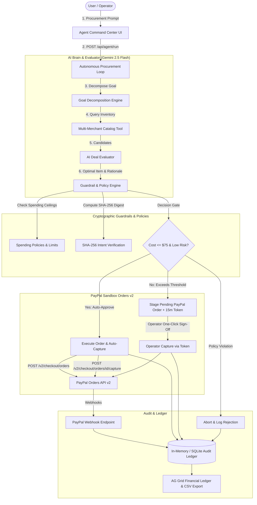

# AgentWallet: Autonomous Agentic Commerce Runtime & Financial Proxy

[](LICENSE)
[](https://nextjs.org/)
[](https://developer.paypal.com/docs/api/orders/v2/)
[](https://ai.google.dev/)
[](https://render.com/)

**AgentWallet** is an autonomous agentic commerce runtime and secure financial proxy that empowers AI agents to research, evaluate, and autonomously purchase items using the **PayPal Orders API v2** and **Vaulting**, backed by cryptographic guardrails and human-in-the-loop approvals.

---

## 🚀 Key Capabilities

- **Autonomous Multi-Merchant Procurement**: AI agents parse unstructured procurement requests, query merchant inventories (Electronics, Cloud Software, Developer Peripherals), and evaluate trade-offs between price, shipping speed, and seller reputation.
- **PayPal Orders API v2 Native Runtime**: Direct server-side checkout integration featuring OAuth2 token caching, itemized breakdown calculation, sandbox order staging, and instant capture execution.
- **Cryptographic Intent Hashing**: Every agent procurement action generates an immutable **SHA-256 intent verification digest**, preventing downstream parameter tampering and ensuring non-repudiation.
- **Human-in-the-Loop Approval Gates**: Autonomous spending is bounded by configurable organization policies (`autoApproveThreshold: $75`, `maxPerTransaction: $150`, `dailyCumulativeLimit: $500`). Transactions exceeding thresholds trigger one-time authorization tokens with 15-minute expiration timers.
- **PayPal Webhooks Reconciliation**: Serverless webhook listener processing `CHECKOUT.ORDER.APPROVED` and `PAYMENT.CAPTURE.COMPLETED` events for real-time order state updates.
- **AG Grid Financial Audit Ledger**: Enterprise-grade auditable ledger table featuring live filtering, multi-column sorting, and CSV export.

---

## 🏛️ System Architecture



---

## 🛠️ Tech Stack

- **Framework**: Next.js 14+ (App Router, React 18, TypeScript)
- **Styling**: Tailwind CSS, Lucide React Icons
- **AI Brain**: `@google/genai` (Gemini 2.5 Flash with structured `responseSchema`)
- **Payments**: PayPal Orders API v2, `@paypal/checkout-server-sdk`, Webhooks Signature Verification
- **Audit & Tables**: `ag-grid-react`, `ag-grid-community`
- **Security**: Node.js Cryptography (`crypto`), SHA-256 Intent Hashing, One-Time Expiration Tokens
- **Deployment**: Render Web Services (`render.yaml`), Docker multi-stage build

---

## ⚙️ Quickstart & Local Setup

### 1. Clone the repository
```bash
git clone https://github.com/Ayush-web28/AgentWallet.git
cd AgentWallet
```

### 2. Install dependencies
```bash
npm install
```

### 3. Configure environment variables
Create a `.env.local` file by copying the example:
```bash
cp .env.example .env.local
```

Fill in your API keys (optional — AgentWallet includes a resilient sandbox simulator mode that runs seamlessly even without external keys):
```env
PAYPAL_CLIENT_ID=your_paypal_sandbox_client_id
PAYPAL_CLIENT_SECRET=your_paypal_sandbox_client_secret
PAYPAL_API_BASE=https://api-m.sandbox.paypal.com
PAYPAL_WEBHOOK_ID=your_paypal_webhook_id
GEMINI_API_KEY=your_gemini_api_key
NEXT_PUBLIC_APP_URL=http://localhost:3000
```

### 4. Run the development server
```bash
npm run dev
```

Open [http://localhost:3000](http://localhost:3000) to access the application.

---

## 💳 PayPal Sandbox Test Accounts

To test live checkout on PayPal Sandbox:
1. Navigate to the **[PayPal Developer Dashboard](https://developer.paypal.com/dashboard/accounts)**.
2. Retrieve or create a **Sandbox Personal (Buyer)** test account:
   - **Email**: `sb-buyer@business.example.com`
   - **Password**: `(Found in Sandbox Account details)`
3. Set your **Client ID** and **Secret** in `.env.local`.
4. Run health check via `GET /api/paypal/health` to verify connectivity.

---

## 🔒 Security & Non-Repudiation Architecture

1. **Deterministic Intent Digest**:
   $$\text{Hash} = \text{SHA-256}(\text{Canonical JSON}(\text{customId}, \text{amount}, \text{currency}, \text{itemId}, \text{merchant}, \text{userPrompt}, \text{timestamp}))$$
2. **Timing-Safe Verification**: Cryptographic comparisons use `crypto.timingSafeEqual` to avoid timing side-channel attacks.
3. **Short-Lived Authorization Tokens**: When human approval is triggered, high-entropy tokens are bound to a strict 15-minute expiration window.
4. **Server-Side Breakdowns**: All calculations (item total + shipping = order total) are validated strictly on the server before transmitting payloads to PayPal.

---

## 🚢 Deployment (Vercel & Render)

### Option A: Deploy on Vercel (Recommended — 1-Click Native Next.js)

Since **AgentWallet** is built on Next.js 14 App Router, Vercel provides zero-configuration serverless hosting:

1. Go to **[vercel.com](https://vercel.com)** and log in with your GitHub account.
2. Click **"Add New..."** > **"Project"**.
3. Import your repository: **`Ayush-web28/AgentWallet`**.
4. Framework Preset will automatically detect **Next.js**.
5. Under **Environment Variables**, add:
   - `PAYPAL_CLIENT_ID` = `your_paypal_sandbox_client_id`
   - `PAYPAL_CLIENT_SECRET` = `your_paypal_sandbox_client_secret`
   - `PAYPAL_API_BASE` = `https://api-m.sandbox.paypal.com`
   - `PAYPAL_WEBHOOK_ID` = `your_webhook_id`
   - `GEMINI_API_KEY` = `your_gemini_api_key`
   - `NEXT_PUBLIC_APP_URL` = `https://<your-project>.vercel.app` *(update after first deploy)*
6. Click **Deploy**. Vercel will build and assign you a live HTTPS domain in under 60 seconds!

#### Deploy via Vercel CLI:
```bash
# 1. Install or run Vercel CLI
npx vercel

# 2. Deploy to production
npx vercel --prod
```

---

### Option B: Deploy on Render

AgentWallet also includes `render.yaml` for Render Web Services:

1. Connect your GitHub repository `https://github.com/Ayush-web28/AgentWallet` to Render.
2. Render automatically detects `render.yaml`.
3. Set your environment variables in the Render Dashboard (`GEMINI_API_KEY`, `PAYPAL_CLIENT_ID`, `PAYPAL_CLIENT_SECRET`).
4. Click **Deploy**.

Alternatively, build using the included production Dockerfile:
```bash
docker build -t agent-wallet .
docker run -p 3000:3000 agent-wallet
```

---

## 📄 License

This project is licensed under the [MIT License](LICENSE).
